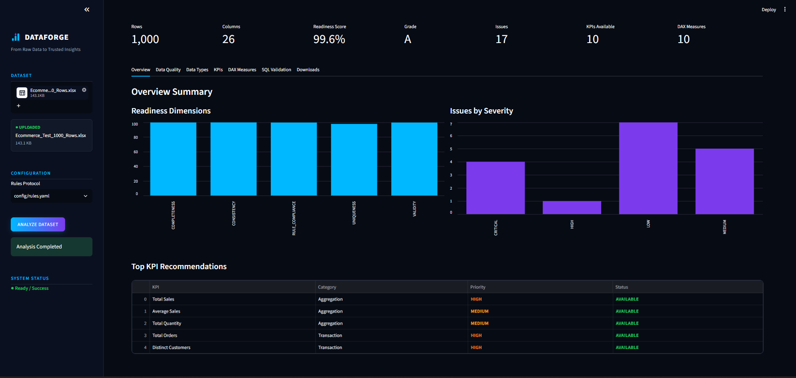
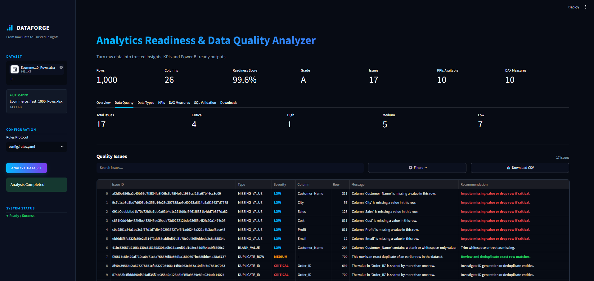
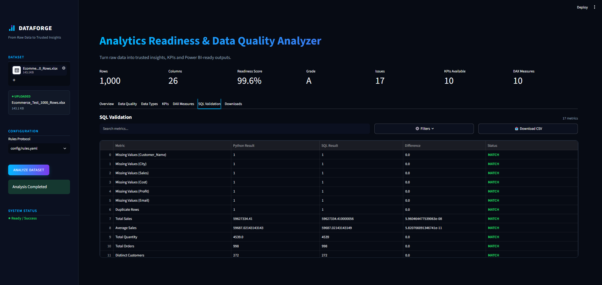
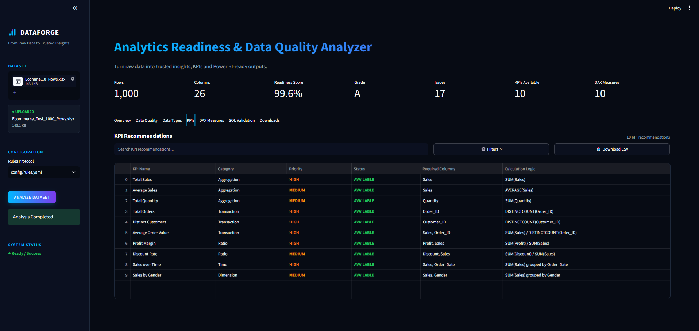
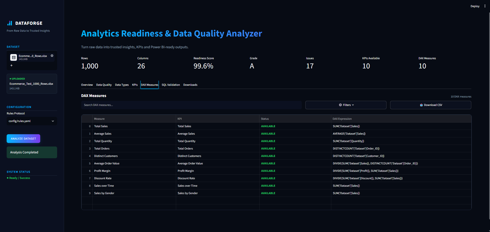

# DATAFORGE: Professional Analytics Engineering & Data Quality Workspace

DATAFORGE is a local, deterministic analytics engineering and data quality platform. It bridges the gap between raw, messy multi-table business data (CSV/Excel) and production Business Intelligence platforms like Power BI by combining automated schema profiling, quality scanning, scoped non-destructive repair, embedded DuckDB SQL analysis, statistical Root Cause Analysis (RCA), and complete project governance.

---

## 1. Problem It Solves

Raw data delivered to analysts is rarely BI-ready. It often suffers from trailing whitespace, ambiguous dates, hidden duplicates, unconfirmed foreign-key relationships, and broken data types. Feeding unverified tables into tools like Power BI or Tableau produces silent errors, misleading dashboard visuals, and untrustworthy metrics.

DATAFORGE solves this with a **100% deterministic, local-first engine**:
* **Zero Black-Box AI:** No non-deterministic LLM hallucinations or external API calls mutating data.
* **Source Immutability:** Raw input datasets remain byte-for-byte untouched; all repairs generate explicitly versioned workspace tables.
* **Cryptographic Verification:** Every exported package computes and verifies SHA-256 checksums in a strict `manifest.json`.

---

## 2. End-to-End Workflow

```
Raw CSV / Excel Files
       │
       ▼
1. Multi-Table Workspace Import & SHA-256 Ingestion
       │
       ▼
2. Deep Profiling & Semantic Type Detection
       │
       ▼
3. Deterministic Quality Scan & Issue Classification
       │
       ▼
4. Scoped Proposals, Interactive Preview & Approval
       │
       ▼
5. Non-Destructive Repair Execution (Source Unchanged)
       │
       ▼
6. Foreign-Key Relationship Detection & Interactive ERD
       │
       ▼
7. Embedded DuckDB SQL Workspace & KPI Center
       │
       ▼
8. Root Cause Analysis (RCA) & Business Question Tracking
       │
       ▼
9. Power BI DataModel, DAX Measures & Blueprint Generation
       │
       ▼
10. Project Governance, Versioning, Lineage & Verified ZIP Export
```

---

## 3. Verified Core Capabilities

### 🔍 Data Quality & Deterministic Repair
* **Multi-Tier Issue Classification:** Issues are explicitly partitioned into `AUTO_FIXABLE` (safe trims, duplicates in flat files), `REVIEW_REQUIRED` (type coercion, assumption-based conversions), and `UNSAFE_TO_FIX` (workbooks with live formulas or merged cells).
* **Pre-Execution Proposal Previews:** Inspect `Old Value` vs. `Proposed Value` row-by-row before approving fixes.
* **Before/After Re-Validation:** Immediate recalculation of data readiness scores with exact delta tracking.
* **Excel Integrity Protection:** Refuses destructive row-deletions on worksheets with merged cells or formulas to prevent formula reference corruption.

### 🔗 Relationship Engine & ER Diagrams
* Primary key and foreign key candidate discovery using overlap ratios and uniqueness constraints.
* Interactive user confirmation for proposed relationships (Accept / Reject).
* Real-time Entity-Relationship Diagram (ERD) rendering via Mermaid and Graphviz.

### ⚡ Embedded DuckDB SQL & Analytics
* **Embedded DuckDB Engine:** In-memory high-performance analytical SQL over all loaded workspace tables.
* **KPI Center & Snapshots:** Define business metrics, compute snapshots, and track historical metric deltas.
* **Root Cause Analysis (RCA):** Safe interactive filter builder comparing affected sub-populations against baselines with strict statistical classification ("Insufficient Evidence", "Observed Association").
* **Schema-Aware Question Tracker:** Suggests relevant analytical questions grounded strictly in loaded schemas and tables.

### 📊 Power BI & BI Handoff
* **Automated DAX Generation:** Synthesizes valid DAX measures from defined KPIs and workspace schemas.
* **Data Model Specification:** Exports clean Star/Snowflake schema definitions.
* **Dashboard Blueprints:** Generates structured visual layouts and chart recommendations.

### 🛡️ Governance, Lineage & Cryptographic Export
* **Run History:** Immutable event audit log of every scan, repair, and transformation.
* **Dataset Versioning:** Full lineage DAG tracking parent-child relationships across table versions.
* **Assumption Register:** Formal analyst documentation register with review lifecycle tracking.
* **Verified Project Export:** Packages raw data, versioned tables, metadata, and reports into a ZIP archive with cryptographic SHA-256 verification via `manifest.json`.

---

## 4. Visual Walkthrough

### Project Overview & Health


### Automated Data Quality Scan


### Embedded SQL Query Workspace


### KPI Recommendations & Analytics


### Power BI DAX Generation


---

## 5. Project Structure

```text
Dataforge/
├── app.py                     # Streamlit multi-page application controller
├── pyproject.toml             # Project configuration and dependencies
├── requirements.txt           # Python package requirements
├── README.md                  # Documentation and setup guide
├── config/
│   └── rules.yaml             # Configurable business quality rules
├── docs/
│   └── images/                # Dashboard interface screenshots
├── src/                       # Core modular engines
│   ├── anomaly_engine.py      # IQR & Z-score anomaly detection
│   ├── assumption_register.py # Analyst assumption governance
│   ├── business_impact.py     # Data issue business impact calculation
│   ├── business_questions.py  # Schema-aware question tracker
│   ├── dashboard_blueprint.py # Power BI dashboard blueprint generator
│   ├── dataset_versioning.py  # Immutable dataset version manager
│   ├── date_analysis_engine.py# Time dimensions, rolling windows, MoM/YoY
│   ├── dax_generator.py       # DAX measure formula generator
│   ├── documentation_generator.py # Real workspace metadata compiler
│   ├── er_generator.py        # ERD visualization (Mermaid / Graphviz)
│   ├── excel_quality.py       # Excel formula and merged-cell integrity
│   ├── feature_engineering.py # Transformative feature generation
│   ├── finding_engine.py      # Structured analytical findings builder
│   ├── historical_readiness.py# Dataset readiness history tracking
│   ├── ingestion.py           # Multi-file ingestion and hashing
│   ├── issue_manager.py       # Quality issue classification & tracking
│   ├── kpi_engine.py          # Metric computation & snapshot comparison
│   ├── lineage_tracker.py     # Transformation lineage DAG generator
│   ├── model_generator.py     # Power BI DataModel & DAX measures
│   ├── project_export.py      # Cryptographic ZIP packager with manifest
│   ├── proposal_generator.py  # Scoped repair proposal generator
│   ├── quality_engine.py      # Rule execution & quality profiler
│   ├── query_manager.py       # Saved SQL query templates & history
│   ├── rca_engine.py          # Root Cause Analysis baseline engine
│   ├── relationship_engine.py # PK/FK relationship inference engine
│   ├── repair_engine.py       # Functional, non-destructive repair engine
│   ├── run_history.py         # Workspace run execution audit log
│   ├── scoring.py             # Analytics readiness scoring
│   ├── segmentation_engine.py # Explicit threshold & percentile segments
│   ├── sql_engine.py          # Embedded DuckDB analytical query engine
│   ├── type_detector.py       # Heuristic & pattern-based semantic typing
│   └── workspace.py           # Multi-table project state & registry
├── ui/                        # User interface layer
│   ├── components.py          # Custom metric cards, alerts, banners
│   ├── layout.py              # Header, navigation, and page containers
│   ├── theme.py               # Design tokens, WCAG AA contrast, dark theme
│   └── pages/                 # Modular page renderers
│       ├── analysis.py        # SQL, KPIs, Questions, RCA, Segments
│       ├── bi.py              # Power BI model, DAX, Blueprints
│       ├── governance.py      # History, Lineage, Assumptions, Export
│       ├── project.py         # Import, Overview, Quality, Cleaning
│       └── tools.py           # Schema explorer & utility tools
└── tests/                     # Comprehensive automated test suite
    ├── acceptance_data/       # Acceptance test CSV fixtures
    ├── test_browser_acceptance.py # End-to-end Playwright acceptance suite
    ├── test_anomaly_engine.py
    ├── test_app_workflow.py
    ├── test_assumption_register.py
    ├── test_business_questions.py
    ├── test_documentation_generator.py
    ├── test_erd_generator.py
    ├── test_erd_integration.py
    ├── test_kpi_snapshots.py
    ├── test_model_generator.py
    ├── test_project_export_integration.py
    ├── test_rca_engine.py
    ├── test_repair_engine.py
    ├── test_sql_engine.py
    └── ... (50+ total test modules)
```

---

## 6. Installation & Setup (Windows)

### Prerequisites
* Windows 10 or 11
* Python 3.11, 3.12, 3.13, or 3.14

### 1. Clone the repository
```powershell
git clone https://github.com/kartikmalaviya11/Dataforge.git
cd Dataforge
```

### 2. Create and activate a virtual environment
```powershell
python -m venv .venv
.venv\Scripts\Activate.ps1
```

### 3. Install dependencies
```powershell
pip install -r requirements.txt
```

### 4. Run the application
```powershell
streamlit run app.py
```
The application will launch automatically in your default browser at `http://localhost:8501`.

---

## 7. Testing & Verification

DATAFORGE maintains strict automated testing across unit, integration, property-based, performance, and real-browser acceptance suites.

### Run Full Test Suite
```powershell
.venv\Scripts\python -m pytest tests -q
```
**Latest Verified Result:**
```text
================ 574 passed, 159 warnings in 108.05s ================
```
* **574 Passed, 0 Failed, 0 Errors.**
* `datetime.utcnow()` has been deprecated since Python 3.12. Python recommends timezone-aware UTC datetime values, such as `datetime.now(datetime.UTC)`. Other warnings in the recorded test run include date-parsing fallbacks and Streamlit parameter deprecations. See the official Python documentation: https://docs.python.org/3/library/datetime.html#datetime.datetime.utcnow.

### Run Playwright Browser Acceptance Suite
```powershell
.venv\Scripts\python -m pytest tests/test_browser_acceptance.py -v
```
**Latest Verified Result:**
```text
============================= 11 passed in 55.09s =============================
```
Exercises 11 complete workflows in a live Chromium browser session:
1. Empty state & initial navigation locking
2. Project creation & multi-file dataset ingestion
3. Profiling, semantic detection & data quality scan
4. Scoped repair approval & raw source immutability verification
5. Custom pattern validation with valid/invalid regex handling
6. Relationship detection & interactive ERD rendering
7. Embedded DuckDB SQL querying & analytical aggregation
8. KPI definition, snapshot creation & comparison deltas
9. Schema-aware business questions & interactive RCA execution
10. Governance tracking (Run History, Versioning, Lineage DAG, DAX generation)
11. Cryptographic ZIP package export with SHA-256 manifest matching

---

## 8. Known Limitations & Architecture Notes

* **Deterministic / Non-Generative Design:** Suggestions and root-cause analyses are strictly computed from table schemas, column distributions, and statistical associations. DATAFORGE deliberately does not invoke generative LLM APIs.
* **Storage Model:** Uses local filesystem paths and embedded in-memory DuckDB. Datasets larger than local RAM require chunked batching.
* **Single Active Session:** The UI workspace operates on one active project context per browser session.

---

## 9. Author

**Kartik Malaviya**<br>
Aspiring Data Analyst & Analytics Engineer<br>
GitHub: [@kartikmalaviya11](https://github.com/kartikmalaviya11)

---

## 10. License & Usage

This project is developed for personal portfolio, educational, and analytics engineering demonstration purposes. All rights reserved by the author. For questions regarding reuse or adaptation, please contact the author via GitHub.
